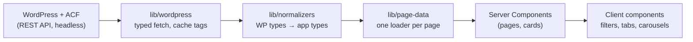

# TravelMeister

Travel guides and hotel recommendations with one specialty: **which hotel room is worth the trip**, checked room by room (the view, the privacy, what to ask for when booking).

A Next.js frontend on top of a headless WordPress, built as a real product and as my portfolio project.

**Live:** [travelmeister.eu](https://travelmeister.eu) · **Stack:** Next.js 16 (App Router) · React 19 · TypeScript · Tailwind CSS 4 · TanStack Query · Zod · Vitest · WordPress + ACF (headless) · Vercel

<!-- Screenshots: add the files to docs/screenshots/, then remove these comments.

-->

---

## What it does

- **Destination guides** with travel styles, picks and "Rooms worth the trip"
- **Hotel articles** in several templates (lists, neighbourhood and style guides, where-to-stay overviews), with filters and a side-by-side comparison table
- **Hotel pages** with a room-by-room table: what you see from each room, privacy level, what to ask for, and how we know (stayed there, confirmed by the hotel, guest photos, satellite images)
- **Explore pages** per destination: everything to stay, eat, drink, see and do, filterable by type, area and tags
- **Related articles** ranked by destination, category and hotel style

<!--
| Destination | Article with filters | Hotel page |
|---|---|---|
|  |  |  |

| Explore | Comparison table | Hotel page on mobile |
|---|---|---|
|  |  |  |
-->

---

## Architecture



**WordPress data is untrusted, app data is not.** Raw responses are typed as `WP…` types (`false` for empty ACF fields, IDs instead of objects). Normalizers turn them into clean app types once, at the boundary: empty values become `null` or `[]`, keys are set, unknown values are dropped. Components never see WordPress shapes.

**Pages load, components render.** Each route has one `getXPageData()` in `lib/page-data` that fetches in parallel, normalizes and decides 404s and redirects. Components only receive finished data.

**Static first.** Content routes are prerendered with `generateStaticParams` and refreshed with time-based revalidation. Every fetch is tagged by the data it depends on (`articles:destination:557`), ready for on-demand revalidation.

---

## Engineering decisions worth a look

| Topic | What and why | Where |
|---|---|---|
| **URL hubs** | Articles about Kreuzberg live under `/berlin/…`. WordPress computes the URL segment on save (nearest destination marked as URL root) instead of the frontend walking the destination tree on every request. Hotel pages answer a wrong segment with a permanent redirect, so URLs survive restructuring. | `wordpress/`, `lib/page-data/hotel-page.ts` |
| **One rule per question** | "Does this hotel have its own page?" is answered in exactly one function and reused by the page (404), the sitemap, static params and every link. | `lib/pages-rules.ts` |
| **Link model** | Each item exposes all its links (`page`, `booking`, `map`); components pick by role (`primaryLink`, `secondaryLink`). `MaybeLink` renders a Next link, an external affiliate link with `rel="sponsored"`, or plain text. | `lib/item-links.ts`, `components/MaybeLink.tsx` |
| **Explore filtering** | A custom hook with derived state: filtered items and per-option counts are computed, never stored. Counts show what each chip *would* return, so dead ends are disabled. | `hooks/useExploreFilters.ts`, `lib/explore.ts` |
| **Related articles** | A small scoring model (same destination, parent, sibling, category, hotel style) with a capped, deterministic result. | `lib/related-articles.ts` |
| **Responsive images** | `next/image` in fill mode inside a box the caller shapes; `sizes` values are named by layout so the browser downloads the right width. | `components/ImageWithFallback.tsx`, `lib/image-sizes.ts` |
| **Card building blocks** | Cards are composed from small parts (`Card`, `CardImage`, `CardTitle`, …) with a stretched-link pattern for fully clickable cards. | `components/card/` |
| **SEO** | Metadata and canonical URLs per page, generated sitemap and robots, permanent redirects from the old site. | `app/sitemap.ts`, `next.config.ts` |
| **Privacy** | Consent categories (necessary, analytics, social media); optional scripts and embeds wait for consent. | `lib/cookie-consent-config.ts` |

### Why there is PHP in a frontend repo

The WordPress REST API cannot filter by ACF fields. A small snippet adds a destination filter (`?destination=ID`, including sub-destinations) and stores the URL hub on save. It is kept in [`wordpress/`](wordpress/) with a README, so the backend logic is versioned and documented next to the code that depends on it.

---

## Tests

Unit and component tests with **Vitest** and **React Testing Library**, focused on logic: filtering and counts, the filter hook, ranking, pagination, grouping, metadata helpers and the WordPress client (paging, error handling) with a mocked `fetch`.

```bash
npm test
```

---

## Project structure

```
app/
  [destinationSlug]/            destination, articles, explore, hotels
  components/                   UI; components/card/ holds the card building blocks
  hooks/                        client hooks (e.g. useExploreFilters)
  lib/
    wordpress/                  typed fetch layer, one file per content type
    normalizers/                WordPress → app types
    page-data/                  one data loader per page
    …                           domain logic: links, rooms, explore, related articles
  types/
    wordpress/                  raw API shapes
    app/                        clean app types
  sitemap.ts, robots.ts
wordpress/                      PHP snippets running in WordPress, with README
```

---

## Running locally

```bash
cp .env.example .env.local   # WORDPRESS_API_URL, SITE_URL
npm install
npm run dev
```

Content comes from the WordPress instance in `WORDPRESS_API_URL` (`…/wp-json/wp/v2`).

---

## What's next

The next version adds a **trip planner**: build a trip day by day (morning, afternoon, evening) from places and experiences, or start from an editorial itinerary.

- client state with Zustand, drag and drop between slots
- Zod schemas shared between frontend and API
- TanStack Query for discovery and optimistic saves
- a NestJS + Postgres API for saved and shareable trips
- small AI helpers that only choose from TravelMeister's own content and are validated before use

---

Built by Alejandro Duarte. AI tools (Claude) were used for reviews, pairing and parts of the implementation; architecture, decisions and the content are my own.
